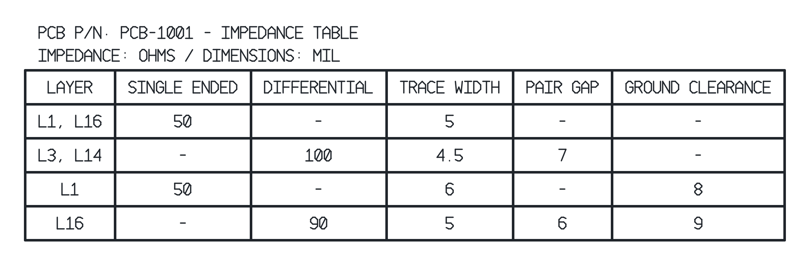

<div align="center">

# Impedance Table

**Your PCB impedance requirements. One clean fabrication table.**

A lightweight Windows desktop app for creating DXF tables for Altium fabrication drawings.

<a href="https://github.com/branggs/Impedance-Chart-Generator-Release/raw/refs/heads/main/downloads/ImpedanceTable-Windows.zip"></a>

**v0.1.0 · First-pass build**  
Windows 10 / 11 · .NET Framework 4.8 · No installer

[Release notes](RELEASE-NOTES.md) · [Direct ZIP download](https://github.com/branggs/Impedance-Chart-Generator-Release/raw/refs/heads/main/downloads/ImpedanceTable-Windows.zip) · [Report an issue](https://github.com/branggs/Impedance-Chart-Generator-Release/issues)

</div>

## From requirements to drawing

- **Save by PCB part number.** Search, reopen, and update existing tables.
- **Single-ended and differential.** Group layers that share the same geometry.
- **Separate spacing callouts.** Pair gap and coplanar ground clearance each get their own column.
- **Automatic dashes.** Unused impedance and spacing cells are handled for you.
- **Live preview.** See the same geometry that will be exported.
- **Windows-style interface.** Segoe UI, blue accents, and Light / Dark / System themes.

## Start in three steps

1. Download the ZIP and extract it to a folder.
2. Open **ImpedanceTable.exe**.
3. Enter your **PCB part number**, add requirements, then **Save board** or **Export DXF**.

No Python, Node, or internet connection is needed to run the app. Export also saves the current board. To change a table later, select its part number in **Saved boards**.

## Example output



*Rendered from an actual exported DXF. The illustrated values are examples, not calculated impedance recommendations.*

| Drawing setting | Output |
|---|---|
| Columns | Layer · Single Ended · Differential · Trace Width · Pair Gap · Ground Clearance |
| Table line width | 10 mil |
| Nominal text height / stroke | 45 mil / 5 mil |
| Entered dimension units | mil or mm, with conversion |
| DXF coordinate units | Always millimeters |
| Text representation | Uppercase drafting strokes, exported as polylines |

**Import into Altium at 1:1 using millimeters as the source units**, even when the table's displayed dimensions are in mils. Text is geometry so its stroke thickness is preserved without installed fonts; edit the saved table in the app and export again to change the wording or values.

## Your saved boards

Use **Open data folder** to locate the board records:

```text
%LOCALAPPDATA%\LayerStack\ImpedanceTable\Boards
```

Saving updates the same record. The previous save is retained as a `.bak` file. Copy the whole folder while the app is closed to back up your boards or move them to another PC. App updates do not remove this data.

## First-pass status

The Windows executable compiled successfully. Fourteen core checks passed, and the sample DXF passed an independent structural audit with no errors or repairs. **The native Windows UI and an actual Altium import have not yet been verified hands-on.** On the first import, confirm the 10 mil grid width and 5 mil text stroke appearance.

This app formats your entered requirements; it does not calculate controlled impedance.
