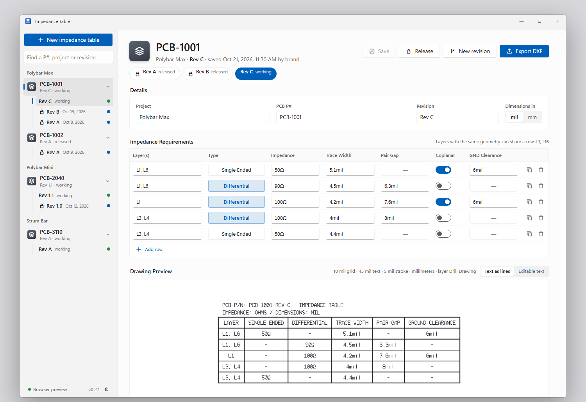
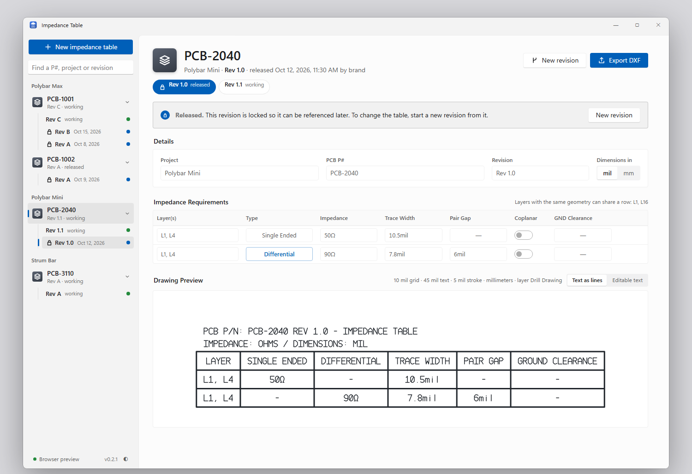

# Impedance Table

**Your PCB's impedance requirements, as a clean fabrication-drawing table for Altium. Organised by project, PCB P# and revision, and shared with your team.** 
Windows 10 and 11 · 64-bit

 

<a href="https://github.com/branggs/Impedance-Chart-Generator-Release/releases/latest/download/Impedance-Table-Windows.exe">
  <picture>
    <source media="(prefers-color-scheme: dark)" srcset=".github/assets/download-windows-dark.svg">
    
  </picture>
</a>

Version 0.2.1 · <a href="https://github.com/branggs/Impedance-Chart-Generator-Release/releases">All versions</a>

  

<picture>
  <source media="(prefers-color-scheme: dark)" srcset=".github/assets/app-dark.png">
  
</picture>

## What it does

- **Fill in the requirements, get the table.** Each row is a layer (or several layers that share the same geometry, like `L1, L6`), Single Ended or Differential, the impedance, trace width, pair gap, and, for coplanar routing, the clearance to ground. Values that don't apply become dashes by themselves.
- **See the drawing as you type.** The preview underneath is the exported drawing: 10 mil grid, 45 mil text with a 5 mil stroke, the PCB P# and revision above the table, and units in every cell (`50Ω`, `5mil`).
- **Export a DXF for Altium.** Import it at **1:1, in millimeters**. The geometry is always in millimeters, even when the table shows mils. Everything is on one layer, named **Drill Drawing**. Choose how the text comes out, above the preview:
  - **Text as lines** (the default): the letters are drawn as lines, so they look exactly like the preview on every PC.
  - **Editable text**: the letters come in as text you can edit in Altium, drawn in Altium's own font.
- **Projects, P#s and revisions.** Every table belongs to a project and a PCB P#, and has revisions named the way you already do it (Rev A, Rev 1.0). **Release** a revision and it's locked for good, so you can always go back to exactly what went to the fab. Changes go into a new revision, copied from any earlier one.
- **Shared with your team through Dropbox.** Point everyone's app at the same Dropbox folder:
  - Each revision is its own file, and a released one is never written again.
  - Saves are made safely, and wait for Dropbox if it's busy with a file.
  - Edits made on other PCs show up by themselves.
  - When someone is editing a revision, everyone else sees who it is.
  - If two people save at the same moment, the app asks which version to keep instead of losing either.

<picture>
  <source media="(prefers-color-scheme: dark)" srcset=".github/assets/released-dark.png">
  
</picture>

## Install

1. Click **Download for Windows** above. You get one file, `Impedance-Table-Windows.exe`.
2. Open it and follow the installer. It installs just for you, so it doesn't need admin rights.
3. Open **Impedance Table** from the Start menu.

**The first time,** Windows may show *"Windows protected your PC"*. Click **More info**, then **Run anyway**. This happens because the app isn't code-signed yet.

## Getting started

1. **Choose the data folder.** The app asks the first time. Pick a folder in your team's Dropbox (it lists your Dropbox folder to start from), and have everyone pick the same one. You can change it later from the folder name at the bottom of the sidebar.
2. **New impedance table:** enter the project, the PCB P# and the first revision (Rev A).
3. **Add rows:** each new row takes the next layer number (L1, L2…); change it if you need to. Click **Single Ended** to switch a row to **Differential** and back. Turn on **Coplanar** to enter a GND clearance.
4. **Save** (Ctrl+S), then **Export DXF**.
5. When the board goes to fab, **Release** the revision. Use **New revision** for the next spin.

**Units:** pick **mil** or **mm** under Dimensions; switching converts what's already entered. Impedance is always in ohms.

The app formats the values you enter. It doesn't calculate impedance: take the geometry from your stackup calculator or your fab.

## What's new in 0.2.1

- **The preview keeps working while you fill a table in.** Switching on Coplanar (or Differential) before entering the clearance (or gap) no longer hides the preview: the missing value is an empty cell, and what's still needed is listed under the preview, row by row.
- **A warning before exporting an incomplete table.** Export DXF lists what's missing; **Export anyway** leaves those cells empty. A revision still has to be complete to be released.
- **One DXF layer, named Drill Drawing**, instead of separate grid and text layers.
- **Editable text** as an export option (see *Export a DXF for Altium* above).

**Not checked yet:** importing these DXFs into Altium: whether it picks the Drill Drawing layer by itself, keeps the 10 mil / 5 mil line widths, and how it shows editable text (centering, the Ω sign). Please report what you see on the [issues page](https://github.com/branggs/Impedance-Chart-Generator-Release/issues).

## What's new in 0.2.0

A complete rebuild, with the same look as the team's other apps.

- **Projects, P#s and revisions**, with **Release** to lock a revision for good, and **New revision** to copy one forward.
- **A shared data folder** for Dropbox and several people: live updates from other PCs, *someone is editing this* notices, and a choice instead of a lost edit when two saves collide.
- **Units in every box and drawing cell**: `50Ω`, `5mil`, right after the number.
- **The revision is on the drawing**, next to the PCB P#.
- **Add row** numbers the next layer for you.
- **One click** switches Single Ended / Differential, and **Coplanar** is a switch.
- Columns renamed: **Impedance**, **Trace Width**, **Pair Gap**, **GND Clearance**.
- The preview fits the window properly, including after maximizing.
- It's now an installer, and no longer needs .NET Framework.

**Coming from 0.1.0:** tables saved in 0.1.0 aren't brought over (it was a first test version). To remove 0.1.0, delete the folder you unzipped it into.

**Not checked yet:** a DXF from this version imported into Altium (the drawing code is the same as 0.1.0's), and the shared folder with two PCs on a real Dropbox. Please report anything odd on the [issues page](https://github.com/branggs/Impedance-Chart-Generator-Release/issues).

Earlier versions are on the [releases page](https://github.com/branggs/Impedance-Chart-Generator-Release/releases).

 

Impedance Table · © 2026

